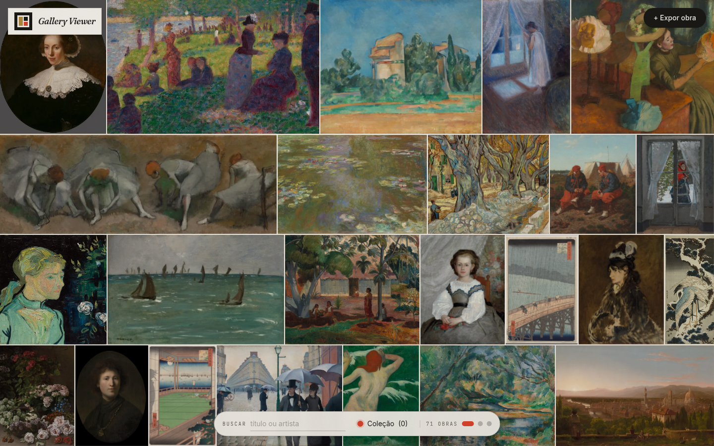
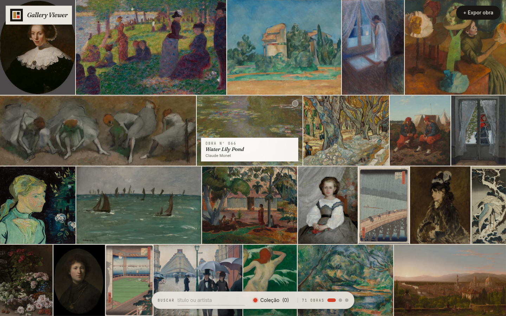
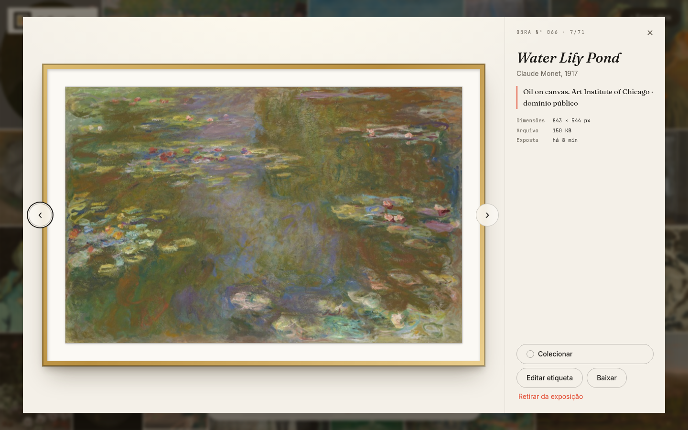
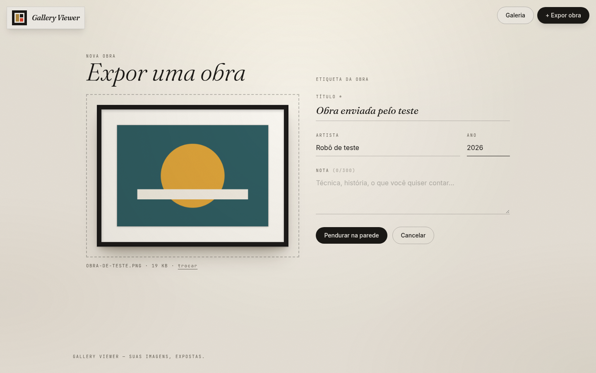
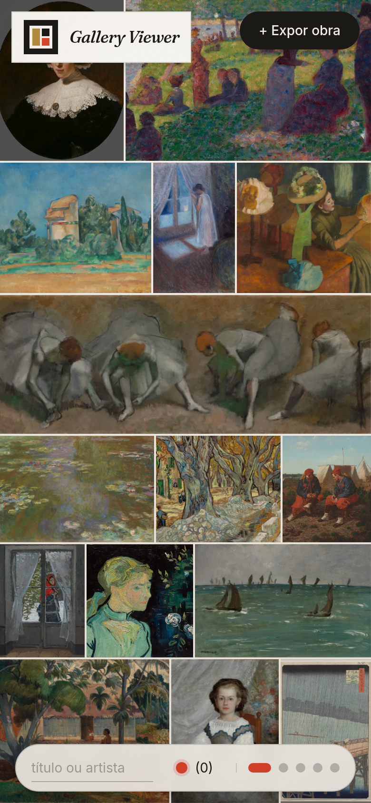

# Gallery Viewer

Uma galeria de arte no navegador: suas imagens viram **obras expostas em um mosaico que cobre a tela inteira**, com
etiqueta de museu, moldura e uma coleção pessoal marcada com o ponto vermelho das galerias.

**Demo online:** https://pedromaxis.github.io/GalleryViewer/ (roda só no navegador, sem servidor: busca, etiquetas e envio de obras funcionam, mas o que você enviar some ao recarregar).

| Mosaico em tela cheia | Etiqueta ao passar o mouse |
| --- | --- |
|  |  |

| Obra emoldurada | Expor uma obra |
| --- | --- |
|  |  |



## O que faz

- **Mosaico em tela cheia**: as obras (de proporções diferentes) são encaixadas em linhas que preenchem a janela de
  ponta a ponta, sem sobra. Cada "parede" ocupa uma tela; role (ou use ↑ ↓) para passar à próxima. Recalcula ao
  redimensionar e funciona em desktop, tablet e celular.
- **Etiqueta de museu**: ao passar o mouse, aparece o nº da obra, título, artista e ano.
- **Contemplar**: a obra abre emoldurada (moldura preta, madeira, dourada ou branca, com passe-partout) e com a
  etiqueta completa; setas do teclado navegam; dá para editar a etiqueta, baixar o arquivo e retirar a obra.
- **Coleção**: o ponto vermelho marca suas obras favoritas (salvo no navegador); "Coleção" filtra só elas.
- **Busca** por título ou artista.
- **Expor uma obra**: arrastar e soltar, prévia emoldurada, título, artista, ano e nota, com barra de progresso.
- Tema único e claro, navegação por teclado, `prefers-reduced-motion` respeitado.

## Estrutura

```
backend/    API Express + SQLite embutido do Node (node:sqlite) + sharp, com testes (node --test)
frontend/   Vite + React + TypeScript + Tailwind, com testes (Vitest)
```

### API

| Rota | O que faz |
| --- | --- |
| `GET /api/images?q=&page=&limit=` | lista (mais novas primeiro), busca em título e artista, paginada (até 60) |
| `POST /api/images` | envia (`multipart`: `image`, `title`, e opcionais `artist`, `year`, `note`) |
| `GET /api/images/:id/file` e `/thumb` | arquivo original e miniatura WebP de 800 px |
| `PATCH /api/images/:id` | atualiza a etiqueta (parcial) |
| `DELETE /api/images/:id` | exclui |

As rotas antigas (`/upload`, `/items`) continuam funcionando.

**Segurança e robustez do envio:** o tipo do arquivo é identificado **pelos bytes** (JPEG, PNG, GIF ou WebP), não pela
extensão nem pelo `Content-Type` do cliente; arquivos corrompidos ou falsos recebem `415`; há limite de tamanho (8 MB,
`MAX_UPLOAD_MB`) e de requisições; as URLs de imagem levam uma **versão** (`?v=`), então o cache longo do navegador
nunca mostra uma imagem antiga se o banco for refeito.

## Como executar

Requer Node.js 22.13+ (o backend usa o SQLite embutido do Node, sem dependências nativas).

```bash
# terminal 1 — API em http://localhost:5000
cd backend
npm install
npm start

# terminal 2 — site em http://localhost:5173 (o Vite faz proxy de /api para a API)
cd frontend
npm install
npm run dev
```

Para preencher a galeria com obras reais de exemplo (dá ~2 minutos por causa do limite de requisições do museu):

```bash
cd backend
npm run seed
```

| Variável (backend) | Padrão | Para quê |
| --- | --- | --- |
| `PORT` | `5000` | porta da API |
| `DATABASE_FILE` | `./database.db` | arquivo do banco; em hospedagem, use um disco persistente |
| `MAX_UPLOAD_MB` | `8` | tamanho máximo por imagem |
| `ALLOWED_ORIGINS` | vazio (qualquer origem) | origens autorizadas (CORS), separadas por vírgula |

No frontend, `VITE_API_URL` aponta para a API em produção (em desenvolvimento fica vazio).

O banco da versão antiga (tabela `cad_imagem`) é **migrado automaticamente** na primeira execução.

## Testes

```bash
cd backend  && npm test            # 20 testes: envio, validação por bytes, busca, paginação, cache, migração...
cd frontend && npm test && npm run lint && npm run build
```

A CI do GitHub Actions roda tudo a cada push e pull request.

## Demo no GitHub Pages

O Pages só serve arquivos estáticos, então o demo troca a API por um catálogo em memória (`frontend/src/lib/demo.ts`), alimentado por `frontend/public/demo/obras.json`: obras CC0 do Cleveland Museum of Art, com as imagens carregadas direto do museu. As do Art Institute ficam de fora porque o servidor de imagens deles recusa carregamento a partir de outros sites. Para regerar o catálogo: `node frontend/scripts/gerar-obras.mjs`; para compilar o demo: `npm --prefix frontend run build:demo`.

## Deploy

- **Frontend** (Vercel/Netlify): build `npm run build`, saída `dist`, variável `VITE_API_URL` com a URL da API.
- **Backend** (Render, Railway, Fly...): `npm start`, com `DATABASE_FILE` apontando para um **volume persistente**
  (em planos gratuitos o disco costuma ser efêmero e as imagens somem a cada deploy) e `ALLOWED_ORIGINS` com o
  endereço do site. Em planos gratuitos a API "dorme"; o site mostra um aviso e permite tentar de novo.

## Créditos das obras de exemplo

As 71 obras do `npm run seed` vêm de acervos abertos, todas marcadas como **domínio público / CC0** pelos museus:

- [Art Institute of Chicago](https://www.artic.edu/open-access) — API pública, com identificação do app (cabeçalho
  `AIC-User-Agent`) e respeitando o limite de ~60 requisições por minuto.
- [Cleveland Museum of Art Open Access](https://www.clevelandart.org/open-access) — imagens CC0.

As imagens e os dados pertencem aos museus e são exibidos aqui como demonstração. A nota de cada obra registra o museu
de origem.

## Sobre o projeto

O Gallery Viewer nasceu como um projeto de estudo, para enviar uma imagem com título e exibi-la em um mosaico. Esta
versão corrige o que estava quebrado e o transforma em uma galeria de verdade: na versão antiga **nenhuma imagem
aparecia** (o frontend usava `item.img_url`, campo que o backend nunca devolveu), o servidor aceitava qualquer arquivo
sem limite de tamanho, todas as imagens eram servidas como `image/jpeg`, e a URL da API estava fixa no código.
